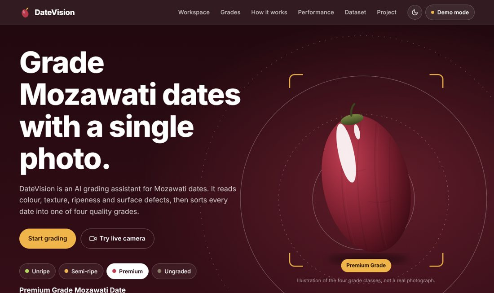
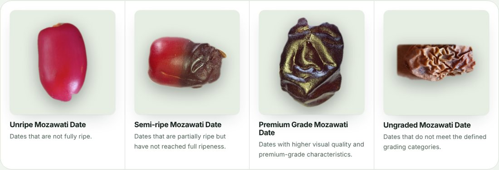

# DateVision

**An Intelligent Deep Learning Framework for Automated Mozawati Date Quality Classification**

DateVision grades Mozawati dates from a single photo. A MobileNetV3-Large model classifies each date into one of four quality grades, and a web app shows the result with a confidence level and a Grad-CAM heatmap.

[](https://colab.research.google.com/github/Ahadbaloch1/DateVision/blob/main/colab/DateVision_Colab_Server.ipynb)

**Live demo (demo mode, no model needed):** https://ahadbaloch1.github.io/DateVision/



## Grades

| Grade | Meaning |
|---|---|
| Unripe | Dates that are not fully ripe. |
| Semi-ripe | Dates that are partially ripe but have not reached full ripeness. |
| Premium | Dates with higher visual quality and premium-grade characteristics. |
| Ungraded | Dates that do not meet the defined grading categories. |



## Features

- **Single photo, batch and live camera** grading in the browser.
- **Confidence threshold** (default 80%). A result below the threshold is shown as "Not confident", with no grade and no percentage.
- **Smart Gatekeeper.** A second, ImageNet-based model blocks photos of people, animals, vehicles and clearly different fruits before grading.
- **Grad-CAM heatmaps** that show which part of the date drove the decision.
- **Batch export:** a ZIP with one folder per grade (plus a `Not_confident` folder) and a CSV with the results.
- **Demo mode**, so the interface can be tried without a model. Demo results are simulated and labelled as such.
- Light and dark themes, responsive layout for phones.

## How it works

```
Browser (docs/index.html)  --photo-->  Colab server (FastAPI + ngrok)  -->  MobileNetV3-Large
        ^                                        |                          + Smart Gatekeeper
        |                                        v                          + Grad-CAM
        +--------  probabilities, gatekeeper verdict, heatmap  -------------+
```

The web app is a single static HTML file. The model runs in Google Colab and is exposed through a small FastAPI server and an ngrok tunnel. The confidence threshold is applied in the web app, so it can be changed without restarting the server.

## Repository structure

```
DateVision/
├── docs/
│   ├── index.html                      the web app (also served by GitHub Pages)
│   └── img/                            screenshots used in this README
├── colab/
│   └── DateVision_Colab_Server.ipynb   loads the model and serves the API
├── model/
│   ├── class_names.json                class order, image size and normalisation used in training
│   └── README.md                       where to put best_model.pth
├── requirements.txt
└── README.md
```

## Quick start

### 1. Try the interface (demo mode)

Open `docs/index.html` in a browser, or use the live demo link above. Demo mode is on by default.

### 2. Connect your own model

1. Put `best_model.pth` and `class_names.json` in a Google Drive folder named `Mozawati_Outputs`. See `model/README.md`.
2. Open `colab/DateVision_Colab_Server.ipynb` in Google Colab and select **Runtime > Change runtime type > GPU**.
3. Create a free [ngrok](https://ngrok.com) account. In Colab, open **Secrets** (the key icon), add a secret named `NGROK_TOKEN` with your authtoken and switch on **Notebook access**.
4. Run the cells from top to bottom. The *Start the server* cell prints a public URL.
5. In the web app, click the status button in the top bar, turn **Demo mode** off, paste the URL, press **Test connection** and then **Save**.

Keep the Colab tab open while you use the app. The URL changes every time the server cell is run.

## Model

| | |
|---|---|
| Architecture | MobileNetV3-Large (transfer learning), `Dropout(0.4)`, 4-way output layer |
| Input | 224 x 224 RGB, ImageNet mean and standard deviation |
| Framework | PyTorch / torchvision |
| Training | Google Colab GPU |
| Explainability | Grad-CAM on the last feature block |
| Target | At least 85% overall accuracy |

The trained weights (`best_model.pth`) are not stored in the repository. See `model/README.md`.

## Dataset

A custom dataset of about 4,000 photographs of Mozawati dates, taken under varied lighting, backgrounds, angles and distances, and labelled by hand.

| Split | Share | Images |
|---|---|---|
| Training | 80% | 3,200 |
| Validation | 10% | 400 |
| Test | 10% | 400 |

The dataset is not included in this repository.

## Limitations

- The system judges visual features only. Taste, aroma and moisture cannot be assessed from a photo.
- The Smart Gatekeeper is a heuristic built on ImageNet labels. It can miss some photos that are not dates, for example a red apple, because ImageNet has no label for it and it can look like a red unripe date. A model trained with an extra "not a date" class would be more reliable.
- Photos taken in very different lighting or on very different backgrounds from the training data can lower the confidence.

## Security note

Never commit your ngrok authtoken. Keep it in Colab Secrets, and do not save a notebook with the token pasted into a cell. If a token was ever shared or committed, reset it in the ngrok dashboard.

## Team

Final year project, Department of Computer Science, University of Makran, Panjgur.

- Muhaiz Ullah
- Jameel Rahim
- Abdul Ahad

Supervisor: Saifullah Baloch  
Co-supervisor: Sir Kamal Khan
